<p align="center">
  <br>
  <picture>
    <source media="(prefers-color-scheme: dark)" srcset="docs/brand/wordmark-dark.svg">
    
  </picture>
</p>

<p align="center"><strong>Plex-native music discovery for your *arr stack.</strong><br>
AI-scored album and artist recommendations, mood search, Plex playlists, and one-tap requests into Lidarr. Self-hosted.</p>

<p align="center">
  <a href="https://github.com/jbuxxy/dj-llama/actions/workflows/ci.yml"></a>
  <a href="https://github.com/jbuxxy/dj-llama/releases"></a>
  <a href="https://github.com/jbuxxy/dj-llama/pkgs/container/dj-llama"></a>
  <a href="LICENSE"></a>
</p>

<picture>
  <source media="(prefers-color-scheme: dark)" srcset="docs/screenshots/dashboard-dark.png">
  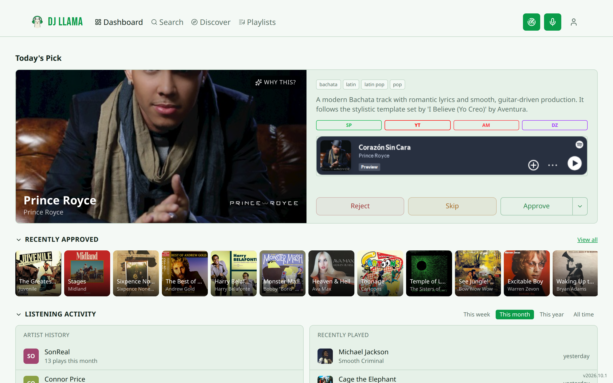
</picture>

DJ Llama learns your taste from what you actually play in Plex, asks your AI provider (plus ListenBrainz and Last.fm) for artists and albums you're missing, scores them, and gives you a review queue. Approve one and it goes straight to Lidarr; the rest of your library becomes daily mixes, seasonal playlists, and mood mixes pushed back into Plex.

Your data stays on your server: one container, an embedded database by default, and Plex as the only sign-in.

## Screenshots

| Discover | Search & request |
| --- | --- |
| 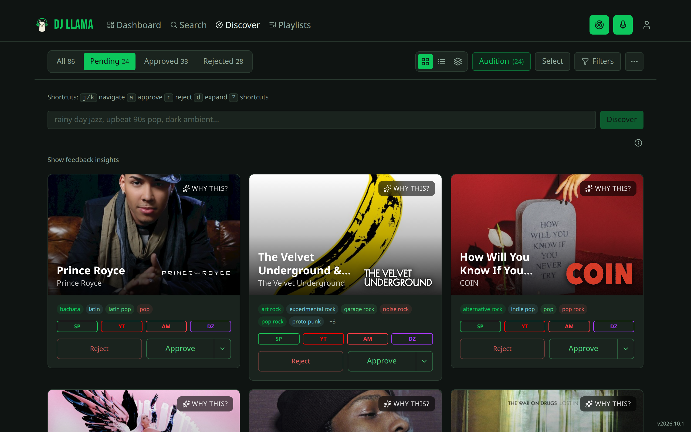 | 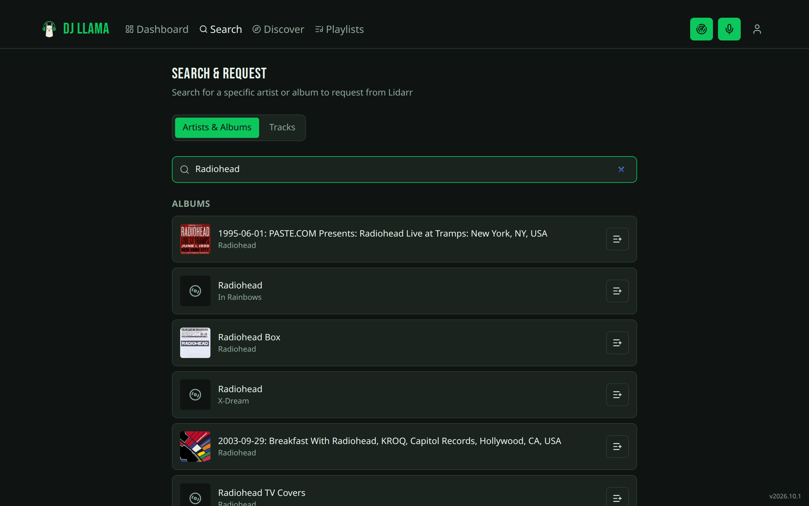 |
| **Playlists** | **Open requests** |
| 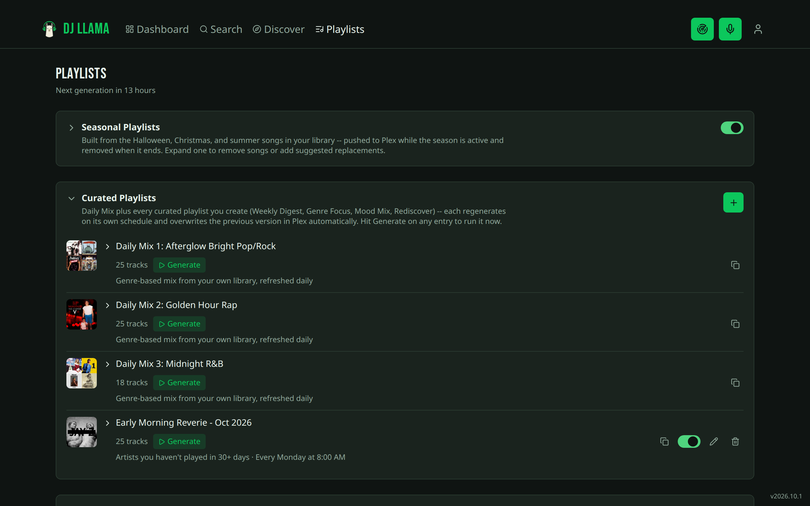 | 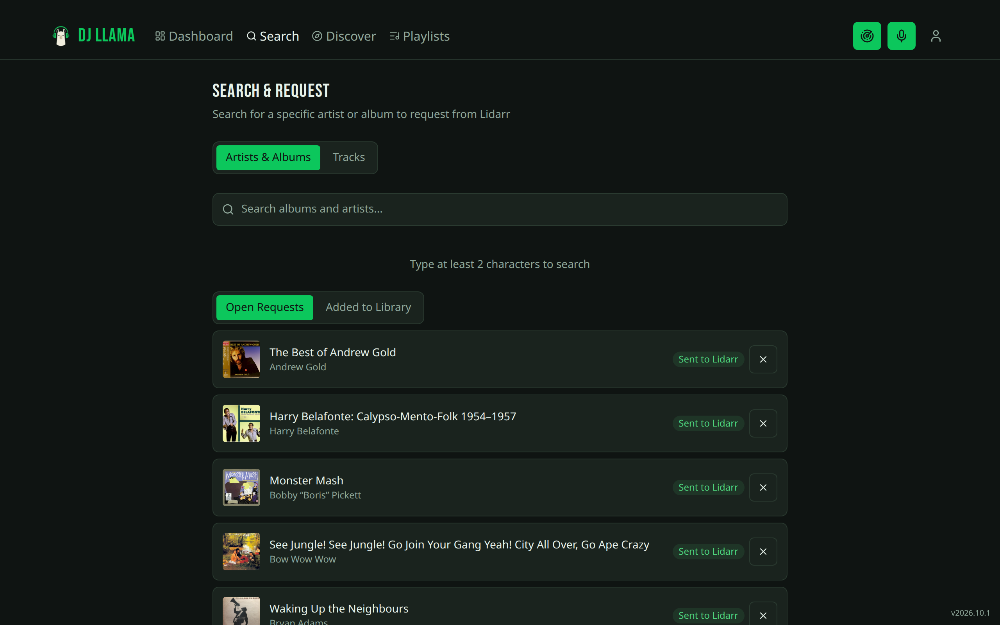 |
| **Analytics** | **Library health** |
| 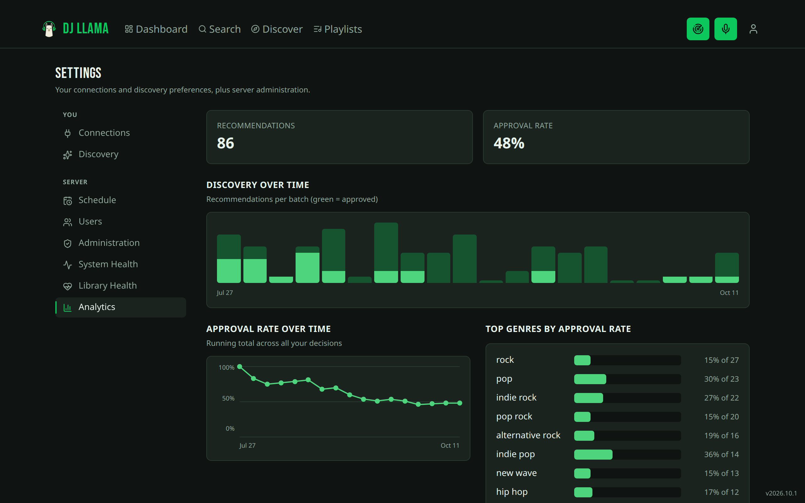 | 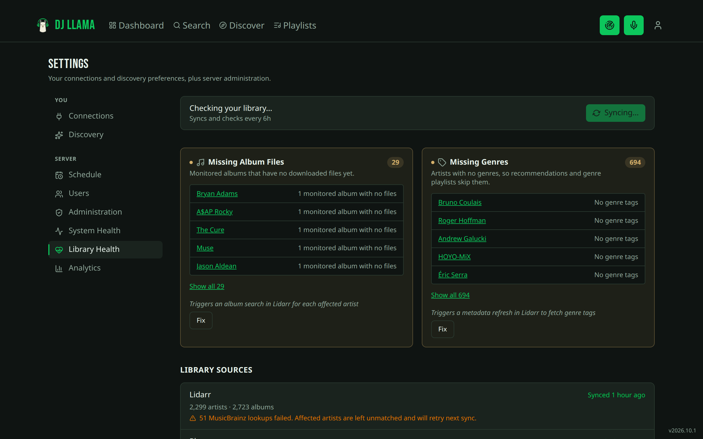 |
| **Discovery settings** | **System health** |
| 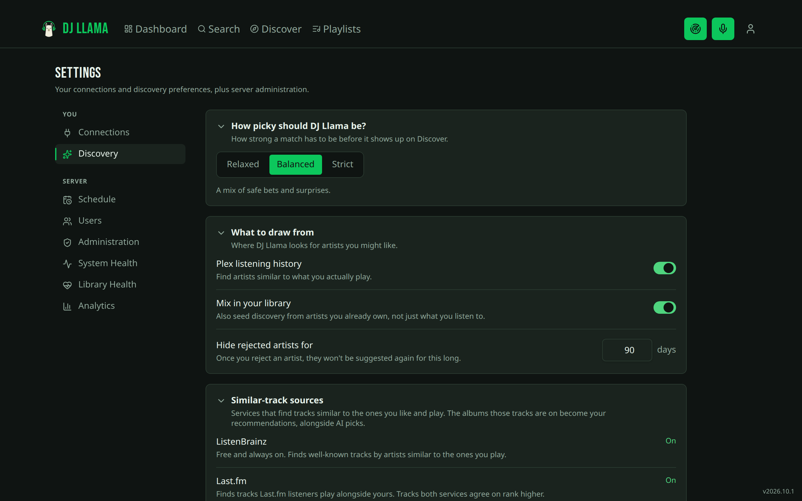 | 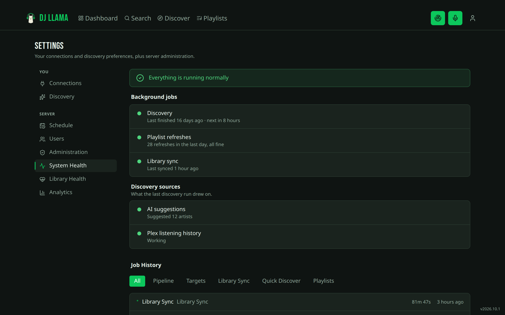 |

<p align="center">
  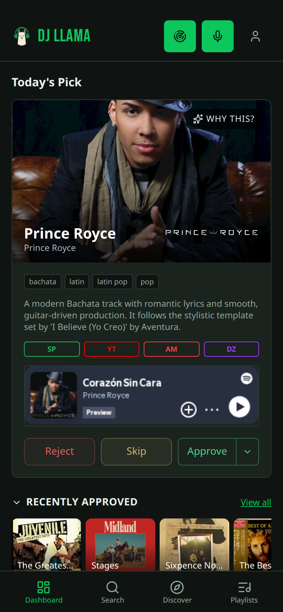
  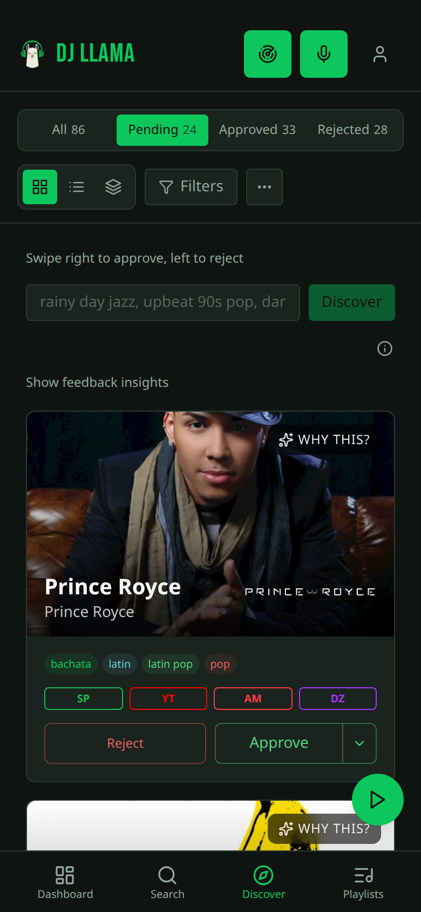
  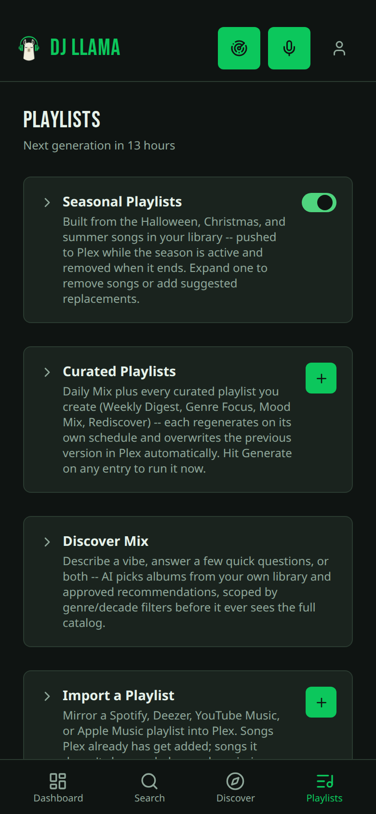
</p>
<p align="center"><sub>Installable as a phone app (PWA), with swipe-to-approve on Discover.</sub></p>

## Features

**Discovery**
- **Album-level recommendations.** DJ Llama suggests individual albums, both gap-fills (missing studio albums from artists you own) and net-new finds, without grabbing whole discographies.
- **AI you choose.** Anthropic, OpenAI, Gemini, Ollama, or any OpenAI-compatible endpoint, including local models.
- **Similar-track sources.** ListenBrainz (always on) and Last.fm find tracks related to what you play; tracks both services agree on rank higher.
- **Weighted scoring that learns.** Consensus, similarity, genre overlap, AI confidence, popularity, and your own approve/reject history all feed the score.
- **Mood search.** *"Rainy day jazz"* or *"something like Boards of Canada but darker"* is a valid query.
- **Review your way.** Cards, a list, or a card stack on desktop; swipe on mobile; keyboard shortcuts (`j`/`k`, `a`, `r`); an Audition queue that plays every pending preview back-to-back.
- **Auto-approve** sends high-scoring picks to Lidarr without waiting for you.
- **Previews** from Spotify, YouTube, Apple Music, and Deezer on every card.

**Library and requests**
- **Search and request** any artist or album from MusicBrainz straight into Lidarr, and track it until it lands.
- **Identify song.** Tap the mic, let it hear what's playing, and DJ Llama (via Shazam) finds the track and offers to request the album.
- **Library sync and health.** Background Lidarr and Plex sync, plus health checks for monitored albums with no files and artists missing genres, each with a one-click fix.
- **No Lidarr required.** Run discovery-only and approve into Plex playlists instead.

**Playlists, pushed to Plex**
- **Daily Mixes** split your liked, recent, and popular tracks into genre mixes, refreshed every day from your own library.
- **Curated playlists** (Weekly Digest, Genre Focus, Mood Mix, Rediscover) on their own schedules.
- **Seasonal playlists** (Halloween, Christmas, Summer, and more) appear when the season starts and retire when it ends.
- **Discover Mix**: describe a vibe and the AI picks albums from your library and approved recommendations.
- **Import a playlist** from Spotify, Deezer, YouTube Music, or Apple Music; songs Plex already has are added, and the rest are listed as missing.

**Running it**
- **Multi-user through Plex.** Anyone with access to your Plex server signs in with their Plex account and gets their own queue, weights, and playlists.
- **Notifications** via Discord or JSON webhooks, ntfy, Telegram, Pushover, or Apprise (80+ services), for finished scans and scheduled digests.
- **Analytics** on approval rates, genre trends, and time-to-act.
- **Ops built in.** Backup and restore, pre-migration auto-backups, job history, system health, and an embedded-to-PostgreSQL migration tool.
- **Export** recommendations as JSON, CSV, M3U, or XSPF.

## Quick start

DJ Llama ships as a Docker image with an embedded database (PGlite), so there's no separate PostgreSQL to run:

```sh
mkdir dj-llama && cd dj-llama
curl -fsSLO https://raw.githubusercontent.com/jbuxxy/dj-llama/main/deploy/docker/docker-compose.pglite.yml
(umask 077 && echo "DJLLAMA_ENCRYPTION_KEY=$(openssl rand -hex 32)" > .env)
docker compose -f docker-compose.pglite.yml up -d
```

Open `http://localhost:3000` and sign in with Plex. The first account to sign in becomes the admin, and the setup wizard walks you through your AI provider and (optionally) Lidarr. Database migrations run automatically on every start.

**External PostgreSQL** instead of the embedded database:

```sh
git clone https://github.com/jbuxxy/dj-llama.git
cd dj-llama/deploy/docker
mkdir -p secrets && chmod 700 secrets
(umask 077 && printf '%s\n' 'change-this-password' > secrets/postgres_password)
cp .env.example .env
echo "DJLLAMA_ENCRYPTION_KEY=$(openssl rand -hex 32)" >> .env
docker compose up -d
```

To switch backends later, use **Settings → Administration → Migrate Database Backend**. It copies everything to the target and leaves the source untouched.

**Build from source** instead of pulling the image: add `-f docker-compose.dev.yml` to either command above, plus `--build`.

### Image tags

| Tag | What it is |
| --- | --- |
| `:stable` | The newest release. Recommended. |
| `:2026.10.1` | A specific release, for pinning. |
| `:latest` | Every commit to `main`, between releases. |

## Requirements

| Service | Required | Purpose |
| --- | --- | --- |
| **Plex** | Yes | Sign-in, listening history, library sync, playlist export |
| **AI provider** | Yes | Anthropic, OpenAI, Gemini, Ollama, or any OpenAI-compatible endpoint |
| **Lidarr** | Optional | Requests and automatic downloads; leave it out to run discovery-only |
| **Database** | Built in | Embedded PGlite by default, or external PostgreSQL via `DATABASE_URL` / `DB_*` |

### Integrations

| Service | Used for | Setup |
| --- | --- | --- |
| **ListenBrainz** | Similar tracks | None; always on |
| **Last.fm** | Similar tracks | Optional API key |
| **MusicBrainz** | Resolving artists and albums | None |
| **Wikidata** | Artist bios and external links | None |
| **Fanart.tv / TheAudioDB** | Artist images | Optional, admin-configured |
| **Shazam** | Identify song | None |
| **Spotify, Deezer, YouTube Music, Apple Music** | Previews and playlist import | None; public endpoints, no account connection |

## How it works

1. **Collect** your Lidarr library (skipped in discovery-only mode).
2. **Analyze** your Plex listening history into a taste profile.
3. **Discover** candidates from the AI, ListenBrainz, Last.fm, and your own library.
4. **Resolve** each one against MusicBrainz, with images and genre-aware disambiguation.
5. **Score** with the weighted formula, tuned by your past decisions.
6. **Filter** out what you already own, artists you rejected recently, and low scores.
7. **Store** the batch for review.

The pipeline runs on the schedule you set in **Settings → Schedule**, or on demand from the scan button in the header.

## Configuration

Most configuration lives in the web UI: connections, discovery preferences, schedules, and administration. For zero-touch setup, set `AI_PROVIDER` and `AI_MODEL` (plus `AI_API_KEY`) in `.env`; see [`deploy/docker/.env.example`](deploy/docker/.env.example) for everything else.

**Encrypt your credentials.** With `DJLLAMA_ENCRYPTION_KEY` set, Plex tokens and API keys are encrypted at rest with AES-256-GCM; without it they're stored in plain text. Use a long random value (`openssl rand -hex 32`), keep it out of version control, and back it up: a restore under a different key lists the credentials you'll need to re-enter, and `scripts/rotate-encryption-key.ts` rotates it in place.

**Behind a reverse proxy**, set `ALLOWED_ORIGIN` to the exact public origin, such as `https://dj-llama.example.com`. It drives CORS, CSRF checks, and the session cookie. Cookies stay `Secure` in production; if you really run over plain HTTP, set `DJLLAMA_ALLOW_INSECURE_COOKIES=true` with a matching `http://` origin and accept that the session cookie can be intercepted.

**Local and OpenAI-compatible AI.** For Open WebUI, choose **OpenAI-Compatible** with a base URL ending in `/api` (for example `http://<open-webui-host>:<port>/api`). Other compatible servers take their root or a `/v1` base. If a local model is slow to load, raise `DJLLAMA_AI_TIMEOUT_SECONDS` (for example `180`).

## Backup and restore

From **Settings → Administration**, or the API:

- **Backup:** `POST /api/v1/admin/backup` returns a JSON file with configuration, users, targets, and recommendation history. Add `?includeCaches=true` to include artist and genre caches.
- **Restore:** `POST /api/v1/admin/restore` takes that file and applies it in one transaction, so a failure rolls back cleanly.
- **Before migrations:** when an upgrade has pending database migrations, DJ Llama saves a backup to `DJLLAMA_BACKUP_DIR` (default `./backups/`) first and keeps the last 14. Disable with `DJLLAMA_AUTO_BACKUP=false`.

## Versioning

Releases use calendar versions: `YEAR.MONTH.N`, so `2026.10.1` is the first release of October 2026. Each release is a `vYYYY.M.N` tag on `main`, published as `ghcr.io/jbuxxy/dj-llama:YYYY.M.N` and `:stable`. Every other commit to `main` publishes `:latest`, whose footer shows the commit beside the version.

## Development

```sh
git clone https://github.com/jbuxxy/dj-llama.git
cd dj-llama
./scripts/dev-setup.sh   # PostgreSQL in Docker, dependencies, migrations, .env
bun run dev
```

Before committing: `bun run lint`, `bun run typecheck`, and `bun run test`. The database-backed tests need `DATABASE_URL` pointing at a Postgres you don't mind them creating and dropping databases on.

Commits follow [Conventional Commits](https://www.conventionalcommits.org/) (`type(scope): description`), enforced by `.githooks/commit-msg`. Turn it on once per clone with `git config --local core.hooksPath .githooks`.

Documentation screenshots come from `scripts/capture-screenshots.ts`, which borrows a signed-in session and scrubs usernames, emails, and hostnames before capturing.

> **Built with AI.** A human sets the direction, designs the architecture, and reviews the output; most code and tests are AI-generated.

## Security

Please report vulnerabilities privately. See [SECURITY.md](SECURITY.md).

## License

MIT. See [LICENSE](LICENSE). DJ Llama began as a fork of [Digarr](https://github.com/iuliandita/digarr) and has since been reworked around Plex-first sign-in and a smaller, focused feature set.
